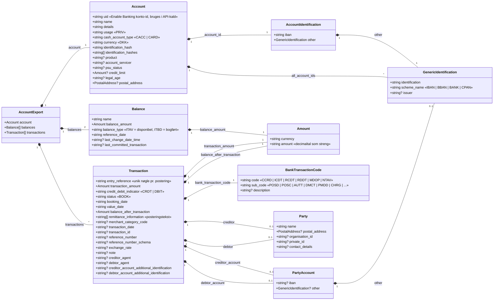

# Datamodel for JSON-filerne i `data/`

Hver fil `data/<IBAN>_<fra>_<til>.json` indeholder ét `AccountExport`-objekt med kontoen, dens saldi og posteringer for perioden. Modellen er udledt af de faktiske data fra Danske Bank via Enable Banking (ISO 20022-inspirerede feltnavne).

## Noter

- `?` markerer felter, der er `null` i alle eller nogle af de hentede data. `PostalAddress` er altid `null` i data og er derfor ikke udfoldet.
- Beløb (`Amount.amount`) leveres som strenge, fx `"-123.45"`, for at undgå flydende-komma-afrunding. Fortegnet fremgår også af `credit_debit_indicator`.
- `Transaction.transaction_id` er `null` fra Danske Bank; brug `entry_reference` som unik nøgle, fx til deduplikering.
- `bank_transaction_code` følger ISO 20022 Bank Transaction Code: `CCRD`=kortbetaling, `ICDT`=afsendt overførsel, `RCDT`=modtaget overførsel, `RDDT`=Betalingsservice/direct debit, `MDOP`=gebyr, `NTAV`=ikke oplyst.
- `debtor_account.other.scheme_name = CPAN` bruges ved kortkøb (kortnummer, maskeret), `BANK` ved bankkonti.
